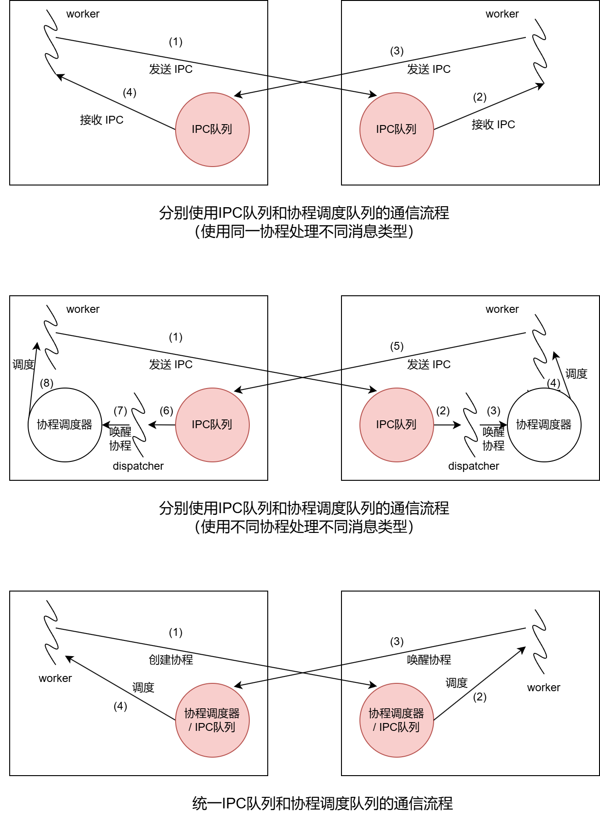

# 思路设计整理

## 之前的初步设计

[io_uring与协程整合-初步设计](iouring与协程整合-初步设计.md)

[iouring与协程整合-初步设计2](iouring与协程整合-初步设计2.md)

## Rel4的异步IPC优化

### Rel4的原有设计

通过类似io_uring的双队列传递IPC信息，通过“用户态中断唤醒dispatcher协程处理CQ条目”或“TAIC硬件调度器”实现阻塞协程的唤醒。

通过TAIC硬件调度器，可以将阻塞的协程绑定到中断号，使得该中断触发时，即唤醒该协程。（那没有TAIC时，这样的设计是否也可行？比如说，把这个协程的Waker注册成中断处理程序？）

### 改进思路(1)

考虑`客户端->服务端->客户端`的通信过程：

客户端：原本正常执行，在发送请求并等待响应的过程中阻塞。其接收的每一个响应都对应于发送的一个请求，不会主动接收其它响应。

服务端：原本阻塞等待，在接收到请求后唤醒处理，所有请求处理完成并发送响应后继续阻塞。主动接收可能来自不同客户端的多个请求。

#### 数据流的改进

从原有的“每一对通信双方设置一对SPSC队列，其中一个为发送队列，一个为接收队列”改为“仅在服务端设置一个MPSC队列”。因为客户端在每次阻塞时只会等待一个响应，因此不需要使用队列缓存多个响应，直接将响应传递给阻塞的客户端即可。

如果服务端进程可以使用多个协程提供服务，则：是使用dispatcher协程管理单消费者队列，并将任务分发给worker协程，还是使用多消费者队列，worker协程直接从队列中接收请求？

优势：

1. 消除了客户端使用队列的开销
2. 更适合同时从多个进程接收请求的服务端

不足：

1. 从SPSC队列改为MPSC（或MPMC）队列引入的同步开销。

仍需进行的工作：

测量不同队列结构的性能差异，以决定采用的队列结构。

#### 控制流的改进

客户端侧的协程唤醒：直接由服务端进行，处理完一个请求后就唤醒对应的协程（通过“跨进程的协程唤醒机制”实现，例如在统一调度环境下直接放入就绪队列，或者在非统一调度环境下使用信号/用户态中断唤醒协程），不需要客户端dispatcher。

服务端侧的协程唤醒：

- 如果服务端只有一个协程：客户端向服务端队列中写入数据时，服务端根据队列在写入前是否为空，向客户端返回“是否需要唤醒”，若需要，则由客户端唤醒服务端协程。
- 如果服务端有多个协程：根据上文中提到的队列结构不同，选择“由客户端唤醒dispatcher协程”或“由客户端唤醒一个worker协程”。

如上所述的协程唤醒机制，均为[“协程阻塞唤醒机制”课题](协程阻塞唤醒机制.md)需要研究的，在一个地址空间中唤醒另一个地址空间的协程的方式。可以采用基于内核级线程、基于用户态中断、基于信号等方式。

如果实现了进程、线程和协程的统一调度，则无论本地址空间的协程还是另一地址空间的协程，均使用相同的调度器。对于客户端，其依旧可以唤醒服务端的协程，并将自身的Waker传递给被唤醒的协程（无论其为dispatcher协程还是worker协程）。对于服务端，其也可以通过客户端的Waker唤醒客户端。因此，该设计可以兼容统一调度。

在非统一调度的环境下，除了协程的唤醒以外还需要考虑进程/内核级线程的唤醒。统一调度则不需要。

#### 协程调度队列与IPC消息队列的结合

在改进控制流之后，如何进行IPC数据与协程数据的传递？（已知：IPC通信时的大部分数据都需要通过共享内存传递。）

- 传递阻塞和唤醒的协程：可以效仿TAIC，为每个协程分配一个标识符，且任何地址空间都能通过该标识符找到该协程。
- 传递IPC数据：**原本的设想是通过获取到的协程TCB传递。不过考虑到各个协程被pin在各个进程的堆中，访问其它进程的协程TCB可能比较困难。**

因此，还是考虑使用`(Option<TaskID>, Option<IPCItem>)`元组作为队列的元素。**该队列同时作为IPC通信队列和协程调度队列。** 将一部分消息传递工作交由进程内部的调度器完成，使进程间的信息传递尽可能简单。

该队列的不同场景下的用法：

- **进程内部的协程调度**：放入`(Some(TaskID), None)`。调度器直接拿出`TaskID`对应的协程运行。
- **客户端向服务器发送请求**：向服务器的队列放入`(None, Some(IPCItem))`。服务器的调度器根据`IPCItem`的类型唤醒或创建相应协程，并将`IPCItem`的数据作为协程的传入参数。客户端阻塞的协程ID也作为`IPCItem`数据的一部分。
- **服务器向客户端发送响应**：向客户端的队列放入`(Some(TaskID), Some(IPCItem))`。客户端的调度器先将`IPCItem`中的数据写入`TaskID`对应协程的相应位置，再运行该协程。因此该协程可以获取到`IPCItem`的内容，并继续向下执行。

该设计目前的问题：

- `IPCItem`的多态性。不同类型IPC的消息长度可能不同，难以放入队列。是否可以强制统一所有`IPCItem`的结构？（最简单的方式，暂时使用该方式）
- 调度队列相比于IPC的单队列的复杂性（例如，可能有多个优先级，或者使用非FIFO结构），是否会影响IPC的性能？

#### 另一种数据流传递方式

在“使用通知源唤醒worker线程”的基础上，获取IPC消息时，从队列中取出消息直到获得自己的消息。从队列中取出的其它协程的消息放在暂存区，使其它协程在唤醒时可直接从暂存区中获得。

这样，在不修改调度器的前提下也可以不需要dispatcher协程，从而获得本设计的一部分优势。（但仍有单独IPC队列的开销）

（在ldh的设计中，通知源唤醒的是dispatcher协程，因为dispatcher协程在未轮询到消息一段时间后会阻塞。不过在分级调度中，dispatcher协程与worker协程同属一个线程中。若worker协程仍在工作，则即使dispatcher协程阻塞了，当前线程仍无法阻塞，还会引入唤醒dispatcher协程的开销；如果没有worker协程在工作，则阻塞整个线程的代码可以直接写在dispatcher协程中，而不用让dispatcher协程阻塞后，让线程的executor睡眠该线程。因此，我认为，通过通知源实现dispatcher协程的睡眠和唤醒意义不大；反而，通过通知源可以直接实现worker协程的唤醒。）

### 改进思路(2)

一般来说，一个服务端协程可以在循环中处理多个请求。从调度粒度上看，此时的协程类似于线程，通过复用同一协程来处理多个任务（请求）来提升性能，类似线程池的使用。

如果服务端进程具有多个worker协程，则要么使用dispatcher协程进行分发，要么将通信队列改为MPMC。

不过，协程的低开销使其可以胜任更细粒度的调度，例如将IO任务与协程一一对应。因此在IPC中，也可以让一个协程对应一个请求，客户端发送一个IPC的过程，即为在服务端进程中创建一个新协程的过程。

如果实现了进程、线程和协程的统一调度，则客户端也可以创建一个新的服务端协程并放入调度器。因此，该设计可以兼容统一调度。

优势：在思路(1)消除了客户端侧的IPC队列与dispatcher协程的基础上更进一步，消除服务端侧的IPC队列与dispatcher协程。（将调度队列用作IPC队列，将协程executor用作dispatcher）

但，使用该思路的前提是，协程的开销低到支持如此频繁的创建和销毁。需要验证协程的开销是否真的这么低，并且为了达到如此低的开销，也需要精简协程的TCB（最理想的情况是，只剩一个`Future`）。

### fastpath

fastpath是seL4中一种实现快速同步IPC（且需保证为调用语义）的机制。似乎未移植到reL4中？可以尝试移植。

### 对两种通信方式性能的理论分析

“使用同一协程处理不同消息类型”的方式（上）因为结构最简单、开销最低，因此性能最高。但其并发性太低：一个进程的所有IPC消息只能在一个CPU核心上处理，且一旦worker阻塞，则所有类型的消息处理都会阻塞。发送IPC消息的过程有时也涉及阻塞等待，这更限制了该方式的使用场景。

为了提高并发性，需要使用不同协程处理不同的消息类型。原本的设计（中）是使用dispatcher协程访问IPC队列接收消息，并唤醒对应的协程。而我改进的设计（下）则为将协程调度器和IPC队列统一，从而避免了dispatcher引入的开销。

原本设计（中）与改进设计（下）的性能比较：

- 关于协程调度器部分，改进设计共享了协程调度器，需要协程调度器具有不同线程/不同CPU核心向其添加任务的功能。如果协程调度器本身支持该功能，则不会引入额外的开销。此外，协程调度器的调度单元从任务变为了`(任务, IPC消息)`二元组，而executor在接到二元组时也需要对进行一些处理后，再运行对应的任务。这里会引入一些开销，但这部分开销在原本的处理机制中也存在（1）。
- 关于IPC队列与dispatcher部分，改进的设计消除了除前面提到的开销（1）以外的所有开销。

（上）与（下）的性能比较：

由于（下）的协程调度器相较于一般IPC队列的复杂度，以及协程的创建释放的开销，（下）的性能低于（上）。（但（上）的不足之前已提及。）之后可以考虑如何使（下）的性能更接近（上）。

## 统一调度机制的优化

zfl实现的进程、线程、协程统一调度的任务模型非常适用于异步系统调用与IPC，因为在此模型中，不会存在“同步阻塞操作同时阻塞了一个线程/进程中的所有协程”的情况，相当于所有的阻塞操作都是异步阻塞操作。

同时，其使调度器可以感知到所有地址空间和特权级中的任务，便于进行整体决策。

然而，其可能会导致地址空间和特权级以协程调度的频率切换（例如，当前有多个用户进程的协程均在运行，它们的优先级相同，则调度时可能导致地址空间的频繁切换），从而增大开销。可能可以通过局部队列解决。

因此需要实现一种调度算法，使其选择就绪任务时，尽可能选择相同地址空间和特权级的任务。用二级队列（全局+局部）近似全局队列？

尽量降低协程的开销，使协程上下文在Future以外尽量保存较少的内容，从而支持协程的频繁创建和释放。

- 先寻找优先级最高的协程，相同优先级再优先调度同一地址空间。
- 可以尝试通过在不同核心间分配任务以优化上条件的达成。

暂定的不完善想法：使不同进程亲和不同的核心，然后每个核心内部采用原本的优先级调度。

任务切换：调研一下zfl使用跳板页进行的地址空间/特权级切换，考虑能否进一步减少切换次数？（例如，进程切换是否有可能只通过陷入内核->切换地址空间->返回用户态完成？不需要内核态的任务切换？）

## 通信路径优化？

原本：

用户程序--异常指令->微内核--异常处理（无法识别的系统调用号）->用户态内核--IPC->驱动进程

通过异步系统调用，可以绕开微内核，用户程序直接和用户态内核通信。不过这需要修改用户程序。此处的异步调用可以考虑直接和驱动进程IPC？那么，用户态内核需要提供驱动进程的tid。

若需要同步调用，则因为异常的处理只能指定一个线程，且在不同参数的系统调用在异常处理流程中没有区别（需要读取线程上下文来区分），因此无法将IO系统调用的异常处理直接转发到驱动进程。不过，用户态内核与驱动的通信可采用异步IPC。

## IO优化

对每个IO设备，会有由不同任务发起的请求。每个请求可对应一个任务。同时，每个上层I/O请求又会经由协议栈映射到一个或多个对底层设备的请求。

一些硬件通过MMIO，提供了类似io_uring的双队列接口（例如固态硬盘常用的NVMe协议）。不过，NVMe的队列自身不提供任何同步机制，需要驱动程序保证每个时刻只有一个线程访问该队列。

若使协程与双队列配合，因为双队列由硬件定义，难以修改。因此无法像系统调用与IPC接口一样，将队列与协程调度器整合。在发送时，仍可使用请求对应的协程填写发送队列（需要处理同步问题）并阻塞。但接收时，要么保留dispatcher协程，用于从接收队列中获取结果并唤醒对应协程；要么在executor获取下一个协程前，从接收队列中获取结果并唤醒对应协程。同时，如果硬件接口支持设置多组队列，则可将一个队列与一个executor对应，以简化“从接收队列中获取结果”的过程。
